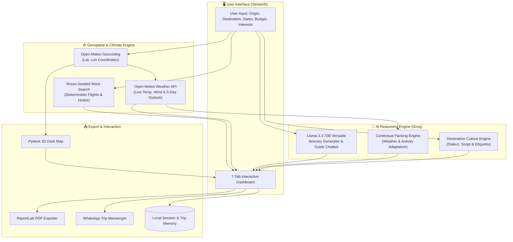
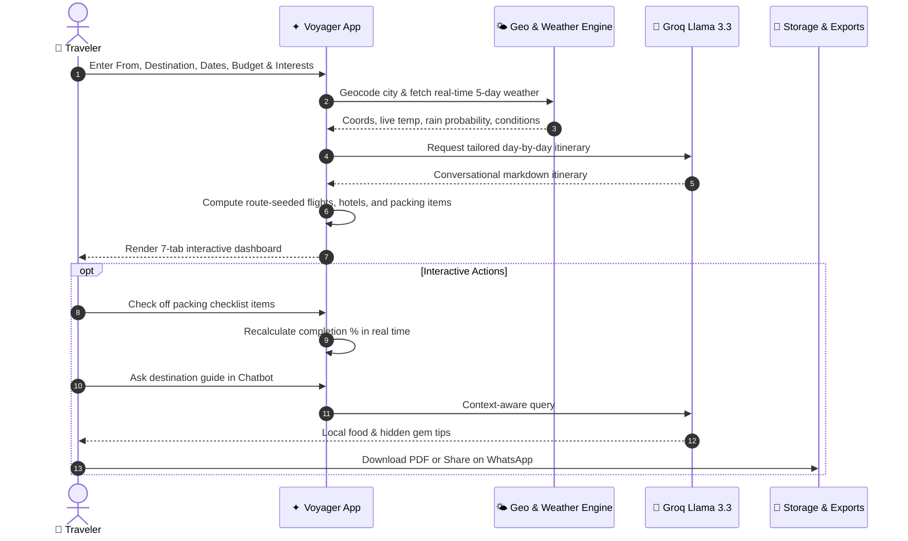

<div align="center">

# ✦ Voyager — AI Travel Planner

### *Sleek, Intelligent, and Context-Aware Travel Orchestration*

[](https://python.org)
[](https://streamlit.io)
[](https://groq.com)
[](https://deckgl.readthedocs.io)
[](https://open-meteo.com)
[](LICENSE)

<br/>

[Explore Features](#-features) • [System Architecture](#-system-architecture) • [Interactive Tabs](#-interactive-tabs-showcase) • [Quick Start](#-quick-start) • [Design System](#-design-system)

</div>

---

## 🧭 Overview

**Voyager** transforms vacation planning into a unified, high-aesthetic experience. Combining **Groq's `llama-3.3-70b-versatile`** with **real-time geospatial geocoding**, **live Open-Meteo weather intelligence**, and **Pydeck 3D mapping**, Voyager delivers bespoke day-by-day itineraries, dynamic packing lists, budget telemetry, and local cultural guides in a tailored dark-mode UI.

---

## ⚡ Key Highlights

```
 ┌─────────────────────────────────────────────────────────────────────────────┐
 │  ✈️ AI Itineraries     │  🗺️ 3D Dark Maps       │  🌤️ Live Weather (5-Day)   │
 │  🧳 Weather Packing    │  🗣️ Local Language     │  💰 Real-Time Budgeting    │
 │  💬 Destination AI     │  📄 PDF Export         │  📱 1-Click WhatsApp Share │
 └─────────────────────────────────────────────────────────────────────────────┘
```

---

## 🏗️ System Architecture

Voyager processes travel requests through a modular pipeline connecting deterministic mock providers, external geospatial APIs, and large language models:



---

## 🗺️ User Experience Flow



---

## ✨ Features

### 1. 🗺️ Interactive 3D Destination Map
- Powered by **Pydeck** with 3D elevation and dark-mode styling.
- Pins for:
  - 🟡 **Destination Center** (Gold)
  - 🟣 **Selected Hotel Stay** (Purple) with live price/night and ratings.
  - 🟢 **Curated Attractions** (Emerald) matched to user preferences.
- Custom tooltips displaying location details on hover.

### 2. 🌤️ Real-Time Weather Forecast & Advisory
- 100% free, real-time meteorological data via **Open-Meteo** (no API key required).
- Current conditions banner (temperature in JetBrains Mono font, weather icon, wind speed).
- Automated AI travel tips based on weather conditions.
- **5-Day Outlook Strip** with daily high/low temperatures and rain probabilities.

### 3. 🧳 Smart AI Packing Checklist
- Dynamically adapts to:
  - **Temperature:** Warm layers if $\le 18^\circ\text{C}$, thermals if $\le 10^\circ\text{C}$, breathable linens if $\ge 26^\circ\text{C}$.
  - **Precipitation:** Compact umbrella and rain gear if rain probability $> 20\%$.
  - **Interests:** Hiking shoes for adventure, modest attire for history/temples, digestive aids for food tours.
- Interactive checkboxes with a live progress bar (`Packed X of Y essentials (Z%)`) and one-click reset.

### 4. 🗣️ Local Phrases & Cultural Guide
- Destination-aware language engine supporting **Hindi, Marathi, Kannada, French, Japanese, Spanish**, and international English courtesy.
- **Phrase Cards:** English translation, native script (e.g., *देवनागरी*, *かな*), and phonetic pronunciation.
- **Local Etiquette:** Tipping customs, temple footwear rules, and dining etiquette.
- **Emergency Helplines:** Quick-dial contacts for Police (`100`), Ambulance (`108`), National Emergency (`112`), and Tourist Support (`1363`).

### 5. ✈️ Interactive Flight & Hotel Comparison
- Compare multiple flights and stays dynamically.
- Total trip expenditure and budget tracking progress bar update instantaneously upon selection.

### 6. 📄 Document Export & Social Share
- One-click **ReportLab PDF generation** for a clean, printable trip voucher.
- One-click **WhatsApp Share link** pre-formatted with flight, hotel, and route details.

---

## 📊 Tab Breakdown

| Tab | Icon | Description | Key Tech |
|---|:---:|---|---|
| **Overview** | 📊 | Flight & hotel choices, 4 metric cards, budget telemetry bar | Streamlit Metrics |
| **Interactive Map** | 🗺️ | 3D scatterplot & text layers with landmark pins | Pydeck & Carto Dark |
| **Live Weather** | 🌤️ | Real-time weather banner, travel advisory, 5-day forecast cards | Open-Meteo API |
| **Smart Packing** | 🧳 | Categorized checklist adapted to climate & duration with progress tracking | Streamlit Session State |
| **Local Phrases** | 🗣️ | Local greetings, pronunciation guide, etiquette rules, emergency numbers | Voyager Culture Engine |
| **Attractions** | 📍 | Curated list of spots matching nature, food, history, or adventure | Attraction Database |
| **Itinerary** | 🗓️ | AI-generated day-by-day itinerary with conversational tips | Groq (`llama-3.3-70b`) |

---

## 🎨 Design System

Voyager implements an agency-grade dark visual identity defined in [`DESIGN_SYSTEM.md`](DESIGN_SYSTEM.md):

| Token | Hex | Preview | Semantic Role |
|---|:---:|:---:|---|
| `--bg-primary` | `#0c0f14` | ⬛ | Main app background canvas |
| `--bg-secondary` | `#131720` | ⬛ | Sidebar & secondary surfaces |
| `--bg-card` | `#161b26` | ⬛ | Metric cards, phrase cards & modals |
| `--accent` | `#6c63ff` | 🟪 | Primary call to action, active states & badges |
| `--success` | `#34d399` | 🟩 | Under-budget indicator & attraction pins |
| `--warning` | `#fbbf24` | 🟨 | Near-budget indicator & destination hub pin |
| `--error` | `#f87171` | 🟥 | Over-budget indicator & emergency numbers |

---

## 🚀 Quick Start

### 1. Clone the Repository
```bash
git clone https://github.com/Lohith-RC/voyager-travel-planner.git
cd voyager-travel-planner
```

### 2. Configure Environment
```bash
# Create and activate virtual environment
python -m venv venv

# Windows
venv\Scripts\activate

# macOS / Linux
source venv/bin/activate

# Install dependencies
pip install -r requirements.txt
```

### 3. Set Up API Keys *(Optional)*
Create a `.env` file in the root directory:
```env
GROQ_API_KEY=your_groq_api_key_here
```
> **Note:** Voyager works gracefully without an API key by providing structured fallback itineraries and local highlights.

### 4. Launch the App
```bash
python -m streamlit run travel_planner.py
```
Open **[http://localhost:8501](http://localhost:8501)** in your browser.

---

## 🛠️ Tech Stack

```
Frontend UI          Streamlit (Custom CSS & DM Sans typography)
Data Visualization   Pydeck (3D Geospatial Deck.gl layers)
Weather Intelligence Open-Meteo Forecast & Geocoding APIs
LLM Intelligence     Groq Cloud SDK (Llama 3.3 70B Versatile)
PDF Generation       ReportLab Platypus Engine
Data Manipulation    Pandas & NumPy
Configuration        python-dotenv
```

---

## 📁 Project Structure

```
voyager-travel-planner/
├── travel_planner.py      # Core Streamlit app (UI, AI logic, Map & Weather)
├── DESIGN_SYSTEM.md       # Visual tokens, typography scales, component specs
├── README.md              # Documentation, diagrams & feature guide
├── requirements.txt       # Python package dependencies
├── travel_memory.json     # Persisted previous trip data
└── .gitignore             # Ignored environments & cache directories
```

---

## 📌 Roadmap

- [x] 🗺️ Interactive 3D Map of attractions & hotel stays (`Pydeck`)
- [x] 🌤️ Live destination weather forecasts & travel advisory (`Open-Meteo`)
- [x] 🧳 Smart AI packing checklist with climate & duration adaptation
- [x] 🗣️ Local language phrases, pronunciation & cultural etiquette guide
- [ ] 💱 Multi-currency converter (INR, USD, EUR, GBP) with live exchange rates
- [ ] 📅 1-click `.ics` calendar sync for Google / Apple Calendar
- [ ] 📁 Multi-trip saved library & side-by-side trip comparison
- [ ] ✈️ Real-time flight & hotel pricing via live travel APIs

---

## 📄 License

Distributed under the MIT License. See `LICENSE` for more information.

<div align="center">
  <sub>Built with ❤️ by Lohith • Powered by Streamlit & Groq</sub>
</div>
